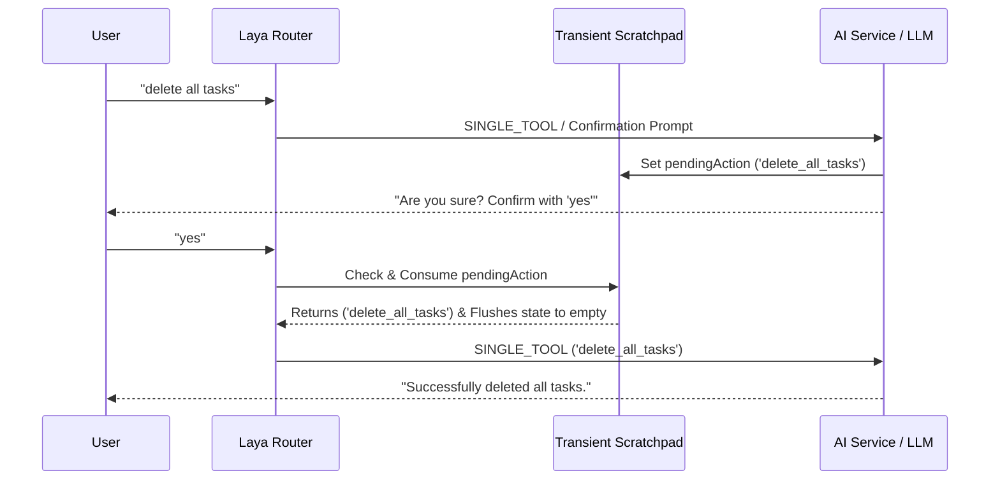

# Implementation Plan - One-Time Transient Scratchpad

Implement a lightweight, token-efficient **Transient Scratchpad** to handle multi-turn confirmation flows (e.g., `"delete all tasks"` -> AI asks for confirmation -> user says `"yes"`) without sending heavy chat history payloads to the API.

## Core Design & Architecture

### Key Components

1. **`scratchpad.service.ts` (`backend/src/services/scratchpad.service.ts`)**:
   - In-memory session-keyed store for `TransientScratchpadState`.
   - `setPendingAction(sessionId, action)`
   - `consumePendingAction(sessionId)`: Retrieves pending action and flushes state in 1 atomic operation.
   - `clear(sessionId)`

2. **`LayaRouter` & `LayaRuleEngine` Integration**:
   - Pass `sessionId` in `LayaRouterOptions`.
   - Before evaluating general rules, check if an active `pendingAction` exists for `sessionId`.
   - If prompt is affirmative (`"yes"`, `"yep"`, `"yeah"`, `"sure"`, `"confirm"`, `"do it"`, `"go ahead"`, `"ok"`):
     - Atomically consume `pendingAction` from scratchpad and return `SINGLE_TOOL` route.
   - If prompt is negative (`"no"`, `"cancel"`, `"stop"`, `"n"`):
     - Clear scratchpad and return `SIMPLE_LLM` cancellation confirmation.

3. **High-Risk Tool / Agent Confirmation Hooks**:
   - When high-risk operations (e.g., `delete_all_tasks`) request user confirmation, populate the transient scratchpad for the active session.

## Verification Plan

1. **Confirmation Flow Test**:
   - User types `"delete all tasks"`.
   - AI responds asking for confirmation.
   - User types `"yes"`.
   - Router consumes scratchpad and executes `delete_all_tasks`.
2. **Cancellation Flow Test**:
   - User types `"delete all tasks"`.
   - AI asks for confirmation.
   - User types `"no"`.
   - Scratchpad is cleared without executing deletion.
3. **Build & Type Checking**:
   - `npm run build:backend`
   - `npm run build:desktop`
